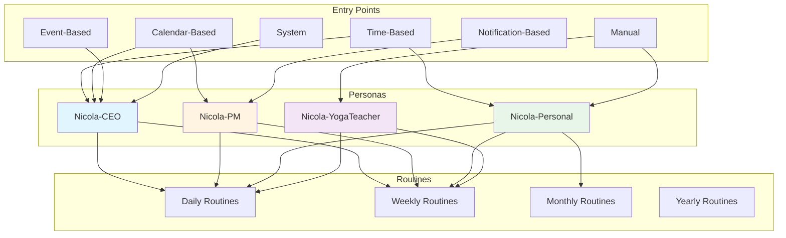
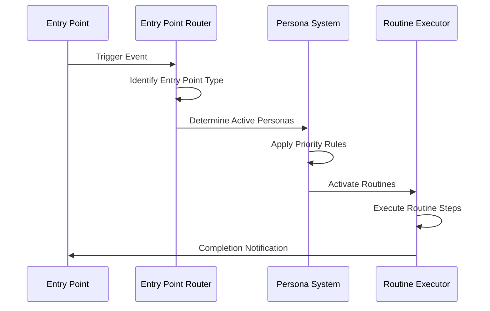

# Nicola's Routines System Architecture

## 📘 Purpose & Scope

This document explains the architectural design of Nicola's routines system, which uses a persona/agent metaphor to manage different aspects of life and work. It covers the persona model, entry point system, routine lifecycle, and integration points with external systems.

## System Architecture Overview

The routines system is built on three core architectural concepts:

1. **Persona/Agent Model**: Different "agents" representing different roles and contexts
2. **Entry Point System**: Triggers and notifications that initiate routines
3. **Routine Lifecycle**: How routines are defined, executed, reviewed, and updated

## Persona/Agent Model

### Persona Definition

A **persona** is a distinct role or context that Nicola operates within. Each persona has:

- **Specific Context**: The domain or area of life it governs
- **Routines**: Routines specific to that persona
- **Entry Points**: Triggers that activate persona-specific routines
- **Priority Level**: How this persona ranks when multiple personas could be active
- **Context Boundaries**: When and where this persona is active

Personas are not mutually exclusive - multiple personas can be active simultaneously, but priority rules determine which routines execute when conflicts arise.

### Persona Inventory

| Persona ID | Name | Primary Context | Entry Points | Priority | Status |
|------------|------|-----------------|--------------|----------|--------|
| CEO | Nicola-CEO | Addictive company operations | Calendar, email, meetings, task notifications | High | Active |
| PM | Nicola-PM | Project management (Project X, etc.) | Task notifications, standups, project tools | Medium | Active |
| Personal | Nicola-Personal | Personal life, relationships, self-care | Calendar, reminders, time-based triggers | Medium | Active |
| Yoga | Nicola-YogaTeacher | Yoga practice and teaching | Time-based, calendar, manual activation | Low | Active |

### Persona Relationships

**Activation Rules**:
- Personas activate based on entry points and context
- Multiple personas can be active simultaneously
- Priority determines routine execution order when conflicts occur
- Context switching happens automatically based on entry points

**Context Boundaries**:
- **CEO Persona**: Active during work hours, meetings, company-related communications
- **PM Persona**: Active during project work, standups, task management activities
- **Personal Persona**: Active during personal time, family time, personal commitments
- **Yoga Teacher Persona**: Active during scheduled practice times, teaching sessions, learning activities

**Priority Resolution**:
When multiple personas could activate routines:
1. CEO persona routines take precedence during work hours
2. PM persona routines activate for project-specific contexts
3. Personal persona routines activate during personal time
4. Yoga Teacher persona routines activate during scheduled practice times
5. Manual activation can override automatic priority rules

## Entry Point System

### Entry Point Types

Entry points are triggers that initiate routines. They fall into six categories:

1. **Time-based**: Scheduled routines triggered by specific times
   - Examples: Morning routine at 07:00, Evening routine at 21:00, Weekly review on Sundays

2. **Calendar-based**: Routines triggered by calendar events
   - Examples: Meeting reminder 15 minutes before, Daily standup preparation, Weekly review scheduled

3. **Notification-based**: Routines triggered by notifications from external systems
   - Examples: Task assigned in OpenProject, Email received, Message received

4. **Event-based**: Routines triggered by specific events
   - Examples: Email received from specific sender, Task status changed, System event occurred

5. **Manual**: Routines explicitly activated by user
   - Examples: "Start morning routine", "Begin yoga practice", "Review weekly tasks"

6. **System**: Routines triggered by system events
   - Examples: Computer startup, App launch, System notification

### Entry Point Architecture

**Entry Point Flow**:
1. Entry point detects trigger (time, event, notification, etc.)
2. Entry point router identifies the type and associated routines
3. Persona system determines which personas should be active
4. Priority rules resolve conflicts if multiple personas compete
5. Routines execute in order based on dependencies
6. Completion notifications update entry point status

**Entry Point Properties**:
- **ID**: Unique identifier (e.g., T001, C001, N001)
- **Name**: Human-readable name
- **Type**: Entry point category
- **Trigger**: Specific condition that activates it
- **Persona**: Which persona(s) it activates
- **Routines**: Which routines it triggers
- **Conditional Logic**: Optional if-then conditions

## Core Principles

The routines system is guided by core principles that ensure consistency and effectiveness:

### Principle 1: Persona-Driven Organization
Routines are organized by persona, not by frequency or type. This ensures context-appropriate routines activate based on current role and situation.

### Principle 2: Entry Point Abstraction
Entry points abstract away the specific implementation details of triggers. This allows routines to work with any notification system or calendar without modification.

### Principle 3: Priority-Based Conflict Resolution
When multiple personas could activate routines, priority rules determine execution order. This prevents routine conflicts and ensures important routines execute first.

### Principle 4: Explicit Context Boundaries
Each persona has clear boundaries defining when it's active. This prevents context confusion and ensures routines execute in appropriate contexts.

### Principle 5: Routine Independence
Routines are independent units that can execute in parallel when possible. Dependencies are explicit and managed by the routine executor.

## Routine Lifecycle

### Creation Phase

1. **Identify Need**: Determine what routine is needed and why
2. **Assign Persona**: Determine which persona(s) this routine belongs to
3. **Define Entry Points**: Identify what triggers this routine
4. **Define Steps**: Break down routine into actionable steps
5. **Set Metadata**: Priority, frequency, time estimate, dependencies
6. **Document**: Add to reference document with full metadata

### Execution Phase

1. **Entry Point Triggered**: Entry point detects trigger condition
2. **Persona Activation**: System determines which personas should activate
3. **Routine Selection**: Routines matching entry point and active personas are selected
4. **Dependency Check**: System checks if dependencies are met
5. **Execution**: Routine steps execute in order
6. **Completion**: Routine completes and updates status

### Review Phase

1. **Scheduled Review**: Regular reviews (weekly, monthly, quarterly)
2. **Effectiveness Assessment**: Evaluate if routine achieves its goals
3. **Usage Analysis**: Check if routine executes as expected
4. **Adjustment**: Modify routine based on findings
5. **Documentation Update**: Update reference documentation

### Update Phase

1. **Change Request**: Identify need for change
2. **Impact Analysis**: Determine impact on related routines and personas
3. **Update Routine**: Modify routine definition
4. **Update Entry Points**: Adjust entry point configuration if needed
5. **Test**: Verify routine works as expected
6. **Document**: Update all relevant documentation

## Integration Points

### Calendar Integration

- **Google Calendar**: Calendar-based entry points read from Google Calendar
- **Event Detection**: System monitors calendar for scheduled events
- **Reminder Triggers**: Entry points trigger based on calendar reminders

### Task Management Integration

- **OpenProject**: Task notifications trigger PM persona routines
- **Task Status Changes**: Event-based entry points monitor task status
- **Task Assignment**: Notification-based entry points trigger on task assignment

### Notification Systems

- **Email**: Email-based entry points trigger routines
- **Slack/Teams**: Message notifications trigger routines
- **System Notifications**: OS-level notifications trigger system entry points

### Time Management

- **System Clock**: Time-based entry points use system clock
- **Timezone Handling**: System handles timezone conversions
- **Recurring Schedules**: Supports daily, weekly, monthly, yearly patterns

## System Components

### Entry Point Router

Routes entry point triggers to appropriate routines based on:
- Entry point type
- Active personas
- Priority rules
- Conditional logic

### Persona Manager

Manages persona activation and context switching:
- Tracks active personas
- Applies priority rules
- Handles context boundaries
- Manages persona state

### Routine Executor

Executes routines based on:
- Entry point triggers
- Active personas
- Routine dependencies
- Execution order

### Notification Handler

Processes notifications from external systems:
- Parses notification content
- Identifies relevant entry points
- Triggers routine execution
- Updates notification status

## References

- [Nicola's Routines Core Principles](nicola-routines-principles.md): Core principles that guide routine definition and execution, ensuring consistency, effectiveness, and alignment with personal and professional goals. - Core principles that guide the system
- [Nicola's Routines](nicola-routines.md): Reference document listing all routines organized by persona, frequency, and entry point, with complete metadata including priority, estimated time, dependencies, and outcomes. - Reference document with all routines
- [Nicola's Routines Personas Reference](nicola-routines-personas.md): Reference document defining all personas in Nicola's routines system, including activation triggers, context boundaries, routines, and entry points for each persona. - Detailed persona definitions
- [Nicola's Routines Entry Points Catalog](nicola-routines-entry-points.md): Reference catalog of all entry points in Nicola's routines system, organized by type, with trigger conditions, associated personas, and triggered routines. - Entry point catalog
- [How to Define a Routine](nicola-routines-howto-define-routine.md): Step-by-step guide for defining new routines in Nicola's routines system, including persona assignment, entry point configuration, and metadata requirements. - How to define new routines
- [How to Activate a Persona](nicola-routines-howto-activate-persona.md): Step-by-step guide for activating personas in Nicola's routines system, including automatic and manual activation, context switching, and multi-persona handling. - How to activate personas
- [How to Configure Entry Points](nicola-routines-howto-configure-entry-point.md): Step-by-step guide for configuring entry points in Nicola's routines system, including notification system setup, trigger configuration, and integration with external systems. - How to configure entry points
